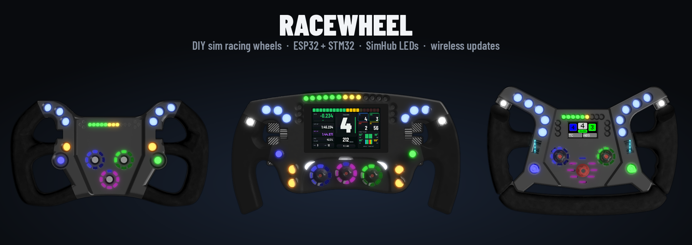

# RaceWheel Flasher

<p align="center"></p>

Published web flasher for RaceWheel steering wheels — update the wheel ESP32, display and STM32 wireless
via a USB dongle, or install a device via USB, right from the browser (Chrome/Edge, Web Serial).

Live at: https://janmannsbart23.github.io/SelfbuildRaceWheel_Flasher/

This repo contains only the built page and firmware binaries — generated from the private
[SelfbuildRaceWheel](https://github.com/janmannsbart23/SelfbuildRaceWheel) repo's
`general/pc/webflasher` with:

```
python tools/make_release.py --out <path to this repo>
```

Commit and push the result here to publish a new release. See the source repo's
`general/pc/webflasher/README.md` and `BUILDING.md` for how the firmware itself is built.

## License

Software: [PolyForm Noncommercial 1.0.0](LICENSE.md) – free for personal and other noncommercial use.
Hardware: [CC BY-NC-SA 4.0](LICENSE-HARDWARE.md). Commercial use requires written permission.
Third-party components keep their own licenses, see [THIRD_PARTY.md](THIRD_PARTY.md).

© 2024–2026 Jan Lenz
